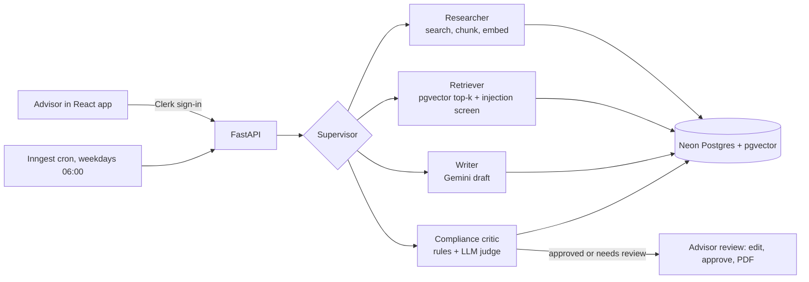

# Wealth Advisory Research Digest Agent

An AI research assistant for wealth advisors. Every morning it reads the latest financial news that matters to each client's portfolio, writes a clear, sourced briefing, checks that briefing against compliance rules, and hands it to the advisor for approval.

It prepares the research; the advisor stays in charge. It does not trade, manage money or give personal financial advice.

## What it does

1. **Understands each client.** An advisor adds a client with their investment themes (for example "semiconductors" or "dividend income") and can upload a holdings CSV so research follows the actual tickers and sectors.
2. **Researches the last few days of news.** The agent searches the web, keeps only recently published articles, splits them into passages and stores them in a vector database.
3. **Finds the most relevant passages.** For every theme it retrieves the best-matching passages, with up to 8 cited sources per briefing.
4. **Writes the briefing.** Gemini drafts a concise, readable morning note from those passages, with a citation for every source.
5. **Checks compliance.** Deterministic rules and an LLM judge both review the draft. The rules catch things like buy/sell directives, guarantees, price targets, one-sided claims and a missing disclaimer. If anything is flagged, the writer revises the draft using specific fix hints.
6. **Hands it to the advisor.** The advisor reads the briefing, edits it (it is re-checked automatically), approves or rejects it, and downloads a PDF.

## Highlights

- **Multi-agent LangGraph pipeline.** A supervisor routes work between a researcher, a retriever, a writer and a compliance critic, with a hard cap on revisions so every run finishes.
- **Real retrieval.** Articles are chunked, embedded with Gemini (384-dimensional vectors) and searched with pgvector on Postgres, rather than pasting raw search results into a prompt.
- **Fresh, cited sources.** Only articles published within the last five days are used, and each briefing cites up to eight of them.
- **Compliance built in.** Rules and an LLM judge run on every draft, and the rules can overrule the judge. Anything uncertain goes to human review instead of being approved automatically.
- **Prompt-injection screening.** Retrieved text is screened with Llama Prompt Guard before the writer ever sees it.
- **Human approval workflow.** Approve, reject or edit a briefing. Every decision is audited, and approving over open flags requires a written reason.
- **Live progress.** A server-sent-events timeline shows each step of a run as it happens, and run history links to the finished briefings.
- **Client management.** Add, edit and delete clients, and upload holdings with strict CSV validation.
- **PDF export** of any briefing, with sources, compliance status and the required disclaimer.
- **Resilient provider layer.** Gemini falls back to Groq automatically, with retries, timeouts and circuit breakers. Every call is logged with its estimated cost.
- **Cost guard.** A daily LLM budget is enforced from real call logs, and per-user rate limits and per-client run locks prevent runaway spending.
- **Secure by design.** Clerk sign-in with RS256 JWT verification, strict per-user data isolation, security headers, request size limits, redacted logs and a Prometheus metrics endpoint.
- **Scheduled runs.** An Inngest cron job prepares briefings for every client each weekday morning, and a duplicate trigger never creates a second briefing.

## Architecture



## Tech stack

| Layer | Technology |
|---|---|
| Agent orchestration | LangGraph (supervisor pattern) |
| LLMs | Google Gemini (drafting, judging, embeddings) with Groq fallback |
| Search | Tavily |
| Safety | Llama Prompt Guard 2 (prompt-injection screening), rule-based compliance engine |
| Backend | Python 3.12, FastAPI, Prisma Client Python, pydantic-settings |
| Database | Neon Postgres with pgvector |
| Auth | Clerk (RS256 JWT) |
| Scheduling | Inngest |
| Observability | JSON logs, Prometheus metrics, LangSmith tracing |
| Frontend | React, TypeScript, Vite, light and dark themes |
| Hosting | Render (API), Vercel (frontend), Neon (database) |

## Project layout

```
backend/    FastAPI app, LangGraph agent, compliance engine, provider client, scheduler
frontend/   React + TypeScript dashboard
eval/       Offline evaluation harness for compliance, retrieval and faithfulness
scripts/    CI helper scripts
render.yaml Render blueprint for the API and the scheduler
```

## Getting started

You need Python 3.12, Node 22, a Postgres database with the `vector` extension (Neon works well) and API keys for Gemini, Tavily and Groq.

**Backend**

```bash
cd backend
python -m venv venv && source venv/bin/activate      # Windows: venv\Scripts\activate
pip install -r requirements.txt -c requirements.lock
cp .env.example .env                                  # add DATABASE_URL and your API keys
prisma generate --schema=schema.prisma
prisma migrate deploy --schema=schema.prisma
python -m uvicorn api:app --port 8010
```

**Frontend**

```bash
cd frontend
npm install
cp .env.example .env                                  # VITE_API_BASE_URL=http://localhost:8010
npm run dev                                           # http://localhost:5173
```

Sign-in with Clerk is optional locally. Leave the Clerk variables empty to use the built-in demo identity.

**Run the tests**

```bash
cd backend && python -m pytest          # 370+ tests, 85% coverage
cd frontend && npm run test:ci             # 37 tests
python eval/run_compliance_eval.py      # offline compliance evaluation
```

## Using the app

1. Sign in and click **Add client**. Enter a name and a few investment themes.
2. Optionally upload a holdings CSV (`ticker, sector, weight`). A sample is in `backend/fixtures/sample_holdings.csv`.
3. Click **Run briefing** and watch the live progress timeline.
4. Open the finished briefing, review the cited sources and the compliance status, then edit, approve or download the PDF.

## Configuration

The most useful settings live in `backend/.env.example`:

| Variable | Purpose |
|---|---|
| `DATABASE_URL` | Neon Postgres connection string |
| `GEMINI_API_KEY`, `TAVILY_API_KEY`, `GROQ_API_KEY` | Provider keys |
| `CLERK_JWKS_URL`, `CLERK_ISSUER` | Enable real sign-in |
| `SOURCE_MAX_AGE_DAYS` / `MAX_CITATIONS` | Recency window (5 days) and sources per briefing (8) |
| `RUN_LIMIT` / `RUN_WINDOW_SECONDS` | Briefing runs allowed per user per window |
| `ADMIN_USER_IDS` | Users who can see the usage panel |
| `APP_ENV=prod` | Production profile with strict startup checks |

## Deployment

The API runs on Render with `render.yaml`, the frontend on Vercel with `frontend/vercel.json`, the database on Neon, sign-in on Clerk and the weekday schedule on Inngest. Set `APP_ENV=prod` and the API validates its own configuration at startup and refuses to run with an unsafe setup, so a misconfiguration is caught immediately.

## Safety and compliance

- Briefings are research summaries for advisors, not investment advice.
- Every draft is checked by deterministic rules and an LLM judge. Rules always run and can veto the judge.
- Uncertain or flagged drafts go to a human reviewer. Nothing is silently approved, and every approval is audited.
- Only an approved briefing can be emailed, and email delivery is off unless explicitly enabled.
- Each user only ever sees their own clients and briefings.

## License

Personal project by Vedant. All rights reserved unless a license file says otherwise.
