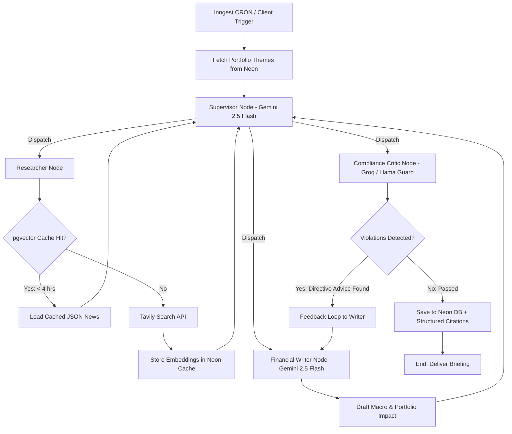

# Autonomous Wealth Advisory Research Digest Agent

An enterprise-grade, multi-agent financial intelligence system that autonomously monitors macroeconomic news, cross-references client portfolio themes, and drafts SEC/FINRA-compliant morning briefings.

Built with a hierarchical **Supervisor Pattern** using **LangGraph**, **Gemini 2.5 Flash**, **Groq**, **Tavily**, and **Neon PostgreSQL (`pgvector`)**.

---

## Architecture Overview

## Sample Briefing Output

### Morning Briefing: Macro View & Portfolio Impact

#### Macro View
- Semiconductor Sector Momentum: Global chip revenues reached $298.5B in Q1, driven by AI data center capex. Trade controls continue to pressure localized supply chains.
- Clean Power Grid Demands: Clean energy capex accounted for 66% of total global energy expenditures, stimulated by grid demand from high-density data centers.

#### Portfolio Impact
##### Semiconductor & Hardware
- Potential Tailwinds: Sustained enterprise AI demand provides operational momentum for power management and logic suppliers.
- Potential Risks: Export restrictions and high bond yields pose multiple compression risks for growth-heavy hardware equities.

Compliance Verification: PASSED (Zero direct buy/sell advisories detected)
